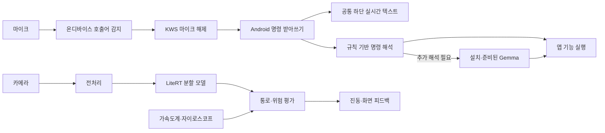
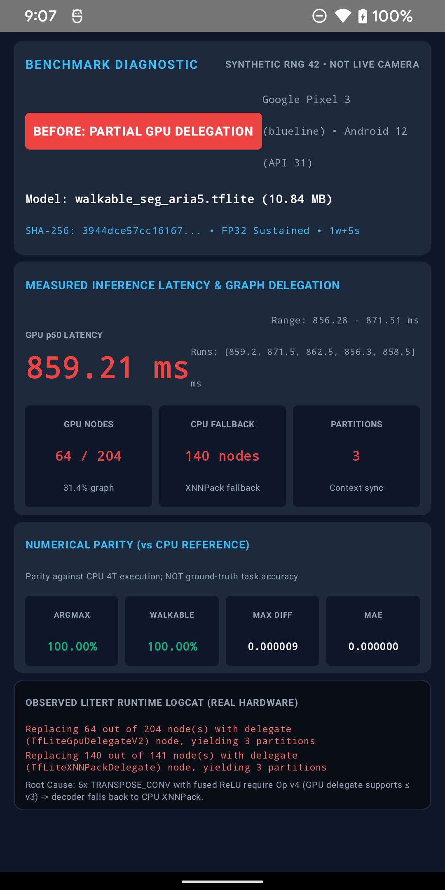
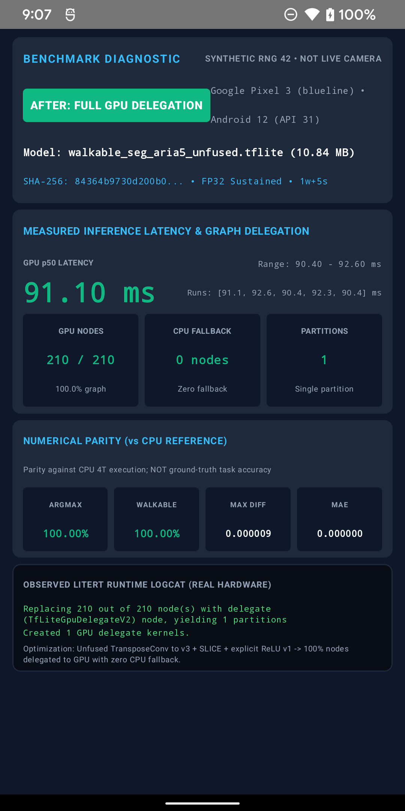

# ARiA 개발 회고 — 발표 준비 자료

작성일: 2026-10-24

기준: 앱 구현 커밋 `5cbf544`와 저장소의 개발·검증 기록. 발표 슬라이드로 옮길 수 있도록 **목표 → 어려웠던 점 → 원인 → 해결 → 확인한 결과 → 남은 과제** 순서로 구성했다. GPU 전후 비교는 2026-10-24 재현 결과를 별도로 표시하고, 기존 기록과 구분한다.

발표용 실제 앱 화면은 [UI 스크린샷 18장 목록과 미리보기](screenshots/ui-20261026/README.md)에서 확인할 수 있다(2026-10-26 촬영).

## 1. 발표에서 전달할 핵심

> ARiA 개발의 핵심은 여러 AI 모델을 실행하는 데서 끝나지 않고, 제한된 스마트폰 자원 안에서 음성·카메라·센서·화면이 올바른 순서로 동작하게 만드는 것이었다.

프로젝트에서 구현한 범위는 Android 앱과 온디바이스 모델의 통합·실행·진단이다. 비전 모델을 앱에서 새로 학습한 것으로 설명하지 않는다. 호출어는 온디바이스 KWS로 처리하지만, 이후 명령 받아쓰기는 Android 시스템 인식기를 사용하므로 전체 음성 처리가 항상 오프라인이라고 설명해서도 안 된다.

### 전체 동작 흐름



## 2. 파트별 요약

| 파트 | 주요 작업 | 가장 설명하기 좋은 어려움 | 해결의 핵심 |
|---|---|---|---|
| 호출어·음성 세션 | KWS와 명령 받아쓰기 분리 | 화면은 대기 중인데 실제로 듣지 않는 상태 | 실제 감지기의 1회 감지 수명주기를 테스트에 반영 |
| 명령 해석·Gemma | 규칙 기반 해석과 선택적 언어 모델 | 무거운 모델이 준비되지 않았을 때의 처리 | 별도 프로세스, 시간 제한, 기본 명령 유지 |
| 카메라·전처리 | CameraX 입력을 모델 규격에 맞춤 | 회전·크롭·색상·오버레이 좌표 불일치 | 명시적 입출력 계약과 좌표 변환 |
| 비전 GPU 최적화 | LiteRT GPU 실행 및 그래프 변환 | GPU를 켰는데 일부 연산은 CPU에서 실행 | 위임 로그 분석, 연산 분리, 수치 비교 |
| 센서·위험 알림 | 방향 상태와 영상 결과 결합 | 오래되거나 불안정한 결과로 경고할 위험 | 신선도·연속 확인·쿨다운·세션 검사 |
| 시작 흐름·UI | 권한·로딩·공통 받아쓰기 표시 | 기능 상태와 사용자가 느끼는 상태의 차이 | 명확한 상태 관리와 사용자 피드백 반영 |
| 기술 검증 | 단위·기기 테스트와 라이선스 고지 | 코드 결함과 시험 환경 문제의 구분 | 조건 확인, 범위별 재실행, 검증 근거 보존 |

## 3. 호출어·음성 인식 파트

### 구현한 내용

- 한국어 호출어를 Sherpa-ONNX KWS로 계속 감지하고, 감지 후 Android `SpeechRecognizer`로 명령 입력을 넘긴다.
- KWS 초기화·실행에 실패하면 Android 기반 호출어 인식 경로로 전환한다.
- 명령 입력, TTS, 중지, 재연결을 세션 상태로 구분하고 오래된 콜백은 무시한다.

### 어려웠던 점: 같은 발음인데 인식 결과가 불규칙했다

사용자는 같은 발음을 반복해도 될 때와 안 될 때가 있다고 보고했다. 단순히 모델 민감도나 발음 문제로 보면 놓치는 로직 결함이 있었다.

실제 KWS 감지기는 호출어를 한 번 감지하면 마이크를 닫고 콜백을 보낸다. 그런데 세션은 마지막 감지 후 1.5초 이내의 콜백을 쿨다운으로 무시하면서, 이미 멈춘 감지기를 다시 시작하지 않았다. 빠른 명령 종료 후 재호출이 이 조건에 걸리면 화면은 `Waiting`인데 실제로는 감지기가 없는 상태가 될 수 있었다.

### 해결과 검증

1. 실제처럼 감지 한 번에 리스너를 소비하는 가짜 감지기로 문제를 재현했다.
2. 쿨다운에 걸린 감지를 버릴 때 기존 감지 시도를 무효화하고, 남은 쿨다운 이후 다시 듣도록 예약했다.
3. 다음 호출 수락뿐 아니라 중지·TTS가 예약된 재시작을 취소하는 경우도 회귀 테스트로 확인했다.

기존 테스트는 감지 후에도 같은 리스너를 계속 호출할 수 있어 실제 동작과 달랐다. **테스트가 통과한다는 사실보다 테스트 대역이 실제 컴포넌트의 수명주기를 제대로 흉내 내는지가 중요했다.**

### 발표용 설명 문장

> 처음에는 인식 모델 문제로 보였지만, 실제로는 중복 감지를 막는 쿨다운과 한 번 감지하면 종료되는 엔진의 동작이 충돌하고 있었습니다. 감지기의 수명주기를 재현한 뒤 재청취 복구를 추가했습니다.

### 남은 과제

- 이 결함은 특정 빠른 재호출 경로를 설명한다. 사용자의 모든 미인식 원인을 확인한 것은 아니다.
- 거리·소음·발화 속도별 성공률과 일반 대화에서의 오탐률은 별도 측정이 필요하다.
- 호출어 직후 마이크를 다른 엔진에 넘기는 구간에서 명령 앞부분이 잘리는지도 계측해야 한다.

근거: [호출어 진단 기록](WAKEWORD_DIAGNOSTIC_FINDINGS_2026-10-23.md), [음성·Gemma 점검 보고서](VOICE_AND_GEMMA_REVIEW_2026-10-23.md), [음성 세션](../app/src/main/java/com/ariateam/aria/speech/VoiceListeningSession.kt), [회귀 테스트](../app/src/test/java/com/ariateam/aria/speech/VoiceListeningSessionWakeWordTest.kt).

## 4. 명령 해석·Gemma 4 E2B 파트

### 구현한 내용

- 홈·설정·안내 소리 같은 기본 명령은 규칙 기반으로 먼저 처리한다.
- 추가 해석이 필요하면 설치되고 준비된 Gemma에 요청한다.
- 언어 모델은 별도 `:language` 프로세스에서 실행하고 준비·추론 시간 초과를 처리한다.
- 출력은 앱에서 지원하는 명령 JSON으로 제한하고, 응답을 다시 파싱해 사용한다.

### 어려웠던 점: 모델의 존재, 준비 완료, 요청 성공은 서로 다른 상태였다

모델 파일이 있다고 바로 명령을 처리할 수 있는 것은 아니다. 로딩이 진행 중일 수도 있고, 메모리 부족이나 긴 초기 추론으로 응답이 늦어질 수도 있다. 이미 사용자가 다음 말을 시작했는데 이전 요청의 결과가 도착하는 상황도 구분해야 했다.

### 해결 방식

| 문제 | 적용한 방식 |
|---|---|
| 기본 명령까지 무거운 모델을 거침 | 규칙 기반 명령을 우선 처리 |
| 로딩·추론이 오래 걸림 | 준비 60초, 첫 해석 30초, 이후 해석 20초 제한 |
| 언어 엔진이 응답하지 않음 | 별도 프로세스와 정리 경로로 앱 전체에 미치는 영향 제한 |
| 이전 명령 결과가 뒤늦게 도착 | 요청 세대 검사를 통해 오래된 결과의 실행 방지 |
| 모델 파일 무결성 | 고정 revision·크기·SHA-256 기준 사용 |

### 확인한 결과와 한계

앱이 지정한 Gemma 4 E2B 파일 크기 2,588,147,712바이트와 SHA-256은 해당 모델 revision의 메타데이터와 일치했다. 다만 점검 당시 Pixel 3에는 모델이 설치되어 있지 않아 **그 기기에서의 초기 로딩 시간·명령 정확도·추론 속도는 측정하지 않았다.** 파일 크기를 그대로 상주 RAM 사용량이라고 설명하지 않는다.

### 발표용 설명 문장

> 언어 모델을 연결하는 것뿐 아니라, 준비되지 않았거나 응답하지 않을 때도 기본 명령이 동작하도록 만드는 데 신경 썼습니다. 모델 연결 구현과 실제 기기의 추론 성능 검증은 구분했습니다.

근거: [음성·Gemma 점검 보고서](VOICE_AND_GEMMA_REVIEW_2026-10-23.md), [명령 조율](../app/src/main/java/com/ariateam/aria/command/CommandCoordinator.kt), [언어 클라이언트](../app/src/main/java/com/ariateam/aria/command/LanguageClient.kt), [언어 서비스](../app/src/main/java/com/ariateam/aria/command/LanguageService.kt).

## 5. 카메라·전처리·모델 관리 파트

### 어려웠던 점 1: 카메라 영상은 모델에 바로 넣을 수 없었다

카메라 입력은 YUV 형식이며 기기 회전, 행 간격, 픽셀 간격을 고려해야 한다. 모델은 `[1, 288, 512, 3]` FLOAT32 RGB 입력을 요구한다. 회전·크롭·정규화가 맞지 않으면 모델이 실행되어도 잘못된 결과를 만들 수 있고, 화면에 표시한 마스크가 실제 영상과 어긋날 수 있다.

**해결:** 회전과 하단 정렬 크롭, YUV→RGB 변환, `[0, 1]` 정규화를 명시적으로 구현하고 프리뷰와 마스크의 좌표 대응을 관리했다. 큰 입력·출력 버퍼를 재사용하고 CameraX에서는 최신 프레임을 우선 처리하도록 구성했다. 처리 후에는 `ImageProxy`를 반드시 반환한다.

### 어려웠던 점 2: 모델 교체 도중 실패하면 기존 모델도 잃을 수 있었다

실행 중인 모델 파일은 메모리 매핑되어 있다. 같은 파일을 덮어쓰거나 새 모델 검증 전에 기존 세션을 폐기하면 실행 중 오류와 복구 실패로 이어질 수 있다.

**해결:** 두 개의 슬롯 중 비활성 슬롯에 새 파일을 준비하고, 텐서 규격과 모델 세션을 검증한 뒤 교체한다. 파일·설정·세션 교체 실패 시 기존 상태를 보존하는 경로를 마련했다. 사용자가 모델을 해제했다면 다음 실행에서 강제로 복원하지 않도록 의도도 저장했다.

### 발표용 설명 문장

> 모델이 실행된다는 사실만으로 입력 영상이 올바르다고 볼 수 없었습니다. 카메라 좌표와 모델 좌표를 맞추고, 모델을 바꾸는 도중 실패해도 기존 동작을 보존하는 과정이 필요했습니다.

근거: [모델 규격](VISION_MODEL.md), [전처리](../app/src/main/java/com/ariateam/aria/vision/VisionFramePreprocessor.kt), [모델 저장소](../app/src/main/java/com/ariateam/aria/vision/VisionModelStore.kt), [카메라 파이프라인](../app/src/main/java/com/ariateam/aria/vision/VisionPipelineController.kt).

## 6. 비전 GPU 최적화 파트

### 어려웠던 점: GPU를 선택해도 충분히 빨라지지 않았다

원본 모델을 GPU Delegate로 실행했을 때 기록상 약 840ms가 걸렸다. 로그를 확인하니 전체 모델이 GPU에 올라간 것이 아니라, 일부 연산이 거부되어 GPU와 CPU로 나뉘어 실행되고 있었다.

원인은 디코더의 `TRANSPOSE_CONV`에 결합된 ReLU가 요구하는 연산자 버전과 GPU 지원 범위의 차이였다. 여기에 첫 번째 역합성곱의 홀수 입력 높이에서 CPU·GPU 패딩 계산 차이도 확인했다.

### 해결 방식

- 결합된 활성화 연산을 `TRANSPOSE_CONV`와 명시적인 `RELU`로 분리했다.
- 첫 번째 역합성곱은 `VALID` 확장 후 `SLICE`를 적용해 CPU 기준과 맞는 출력을 만들었다.
- 변환 전후 모델을 합성 입력으로 비교하고 CPU·GPU의 수치 오차와 클래스 일치율을 확인했다.
- 더 빠른 FP16 실행은 수치 차이가 있어 진단용으로 구분하고, 기본 실행은 GPU FP32로 유지했다.

### 연산 그래프가 바뀐 부분

```text
BEFORE: TRANSPOSE_CONV(v4, fused RELU)
        → GPU 지원 범위 초과 → CPU 폴백 + GPU/CPU 분할 실행

AFTER:  TRANSPOSE_CONV(v3, activation NONE) → RELU(v1)
        첫 디코더: VALID(19×33) → SLICE(18×32) → RELU
        → 지원되는 연산으로 구성 → GPU 단일 파티션
```

학습 가중치를 다시 학습하거나 바꾼 작업이 아니라 실행 그래프를 변환한 작업이다. ReLU 분리로 연산자 버전 문제를 해결하고, 별도의 `VALID + SLICE`로 첫 디코더의 패딩 정렬을 보정했다. 속도 개선과 출력 보존을 각각 검증해야 하는 이유도 여기에 있다.

### 실제 기기 재현: Before / After (2026-10-24)

아래는 Pixel 3에서 원본·변환 모델을 실제로 실행한 뒤, 관측 결과를 표시한 **디버그 진단 화면의 원본 스크린샷**이다. 합성 RNG 42 입력을 사용한 모델 단독 벤치마크이며 실시간 카메라 화면이 아니다. 이미지에 표시된 위임 수치는 해당 실행의 LiteRT 로그에서 추출했다.

| Before — 원본 그래프 | After — 변환 그래프 |
|---|---|
|  |  |

[Before 원본 PNG](evidence/gpu-20261024/before_gpu_partial_delegation.png) · [After 원본 PNG](evidence/gpu-20261024/after_gpu_full_delegation.png) · [측정 JSON](evidence/gpu-20261024/gpu-evidence-20261024.json) · [Before 로그](evidence/gpu-20261024/raw_logcat_before.txt) · [After 로그](evidence/gpu-20261024/raw_logcat_after.txt) · [재현 절차](evidence/gpu-20261024/REPORT.md)

측정 시작: **2026-10-24 21:06:52 KST**, Pixel 3 / Android 12 / Adreno 630 / LiteRT 1.4.2. 두 모델 모두 `precisionLossAllowed=false`, `SUSTAINED_SPEED`, 동일 RNG 42 FLOAT32 입력을 사용했다. 각 GPU 실행은 워밍업 1회 후 5회를 측정했으며 모델 로딩·GPU 커널 준비 시간은 p50에 포함하지 않았다.

| 이번 재현 항목 | Before — 원본 | After — 변환 |
|---|---:|---:|
| GPU 위임 노드 | 64 / 204 | 210 / 210 |
| CPU 폴백 노드 | 140 | 0 |
| GPU 파티션 수 | 3 | 1 |
| 순수 추론 p50 | **859.21ms** | **91.10ms** |
| 5회 범위 | 856.28~871.51ms | 90.40~92.60ms |
| CPU 기준 argmax 일치율 | 100.00% | 100.00% |
| CPU 기준 maxDiff (소수 6자리) | 0.000009 | 0.000009 |
| 배터리 온도 시작→종료 | 29.8→29.8°C | 29.6→29.6°C |
| Android thermal status 시작→종료 | 0→0 | 0→0 |

이 실행의 p50 비율은 **약 9.43배**다. 원본→변환 순서의 단일 짧은 실행이며 발열·시험 순서를 완전히 통제한 장기 성능 평가가 아니다. 합성 입력 하나에 대한 CPU 기준 일치율은 실제 장면 정확도가 아니고, `MAE=0.000000` 표시는 소수 6자리 반올림 결과다. 카메라·전처리·후처리와 초기 준비 시간은 이 추론 시간에 포함하지 않는다.

화면의 `1w+5s`는 워밍업 1회와 측정 5회를 의미한다. GPU·XNNPACK의 실제 위임 로그와 비교 지표를 한 화면에서 확인할 수 있으며, 원인과 변환 방식의 전체 설명은 이 절의 본문에 제공한다.

이번 실행에서는 변환 모델의 위임 로그가 **210/210**으로 관측됐다. 아래의 과거 기록인 209/209와 구분하며, 발표 이미지와 이번 비교에서는 첨부된 실제 로그의 210/210을 사용한다. 그래프 변환으로 연산 수가 늘어도 지원 가능한 연산으로 구성해 GPU 파티션을 유지하는 것이 핵심이다.

```text
BEFORE: Replacing 64 out of 204 node(s) with delegate
        (TfLiteGpuDelegateV2) node, yielding 3 partitions
AFTER:  Replacing 210 out of 210 node(s) with delegate
        (TfLiteGpuDelegateV2) node, yielding 1 partitions
```

이 로그는 부분 위임과 단일 파티션을 직접 보여준다. `TRANSPOSE_CONV` v4 원인과 패딩 보정 설명은 기존 그래프 분석 및 변환 도구에 근거한다. GPU↔CPU 복사 비용을 별도 프로파일러로 분해 측정한 것은 아니므로, 전체 개선을 복사 비용 하나로 단정하지 않는다.

### 이전 검증 기록 — 이번 재현과 분리

다음은 기존 문서에 남아 있는 Pixel 3 측정 기록이며 이번 문서 작성 중 새로 측정한 값이 아니다.

| 항목 | 관측 결과 | 설명 시 주의점 |
|---|---|---|
| 변환 모델 GPU 위임 | 해당 그래프 기록에서 209/209 노드, 단일 파티션 | 모델 파일·런타임에 종속된 결과 |
| GPU FP32 순수 모델 프로브 | 약 90.07ms | 카메라 입력부터 화면 표시까지의 전체 시간이 아님 |
| GPU FP32 실제 파이프라인 | 여러 기록에서 약 7.75~8.96 FPS | 약 21초 관측 구간이며 장시간 고정 성능 보장 아님 |
| 변환 전후 CPU 비교 | 세 합성 입력에서 maxDiff 0, 클래스 일치 100% | 실제 장면의 정답 정확도가 아닌 변환 전후 수치 비교 |
| GPU FP32와 CPU 비교 | 일부 합성 입력 100%, 0 입력은 147,456픽셀 중 2픽셀 차이 기록 | CPU 결과도 정답 레이블이 아니라 비교 기준 |

온도·시험 순서·입력 조건이 다른 기록을 섞어 “항상 몇 배 빨라졌다”고 단정하지 않는다. FPS와 추론 시간도 서로 다른 지표로 설명한다.

### 발표용 설명 문장

> GPU 옵션을 켜는 것과 모든 연산이 GPU에서 실행되는 것은 달랐습니다. 위임 로그로 CPU 폴백 원인을 찾고 그래프를 변환한 뒤, 속도뿐 아니라 결과의 수치적 일치도 함께 확인했습니다.

근거: [비전 모델·그래프 변환 기록](VISION_MODEL.md), [기기 검증 기록](VISION_VALIDATION.md), [변환 도구](../tools/vision/unfuse_transpose_conv.py), [백엔드 비교 테스트](../app/src/androidTest/java/com/ariateam/aria/vision/VisionBackendComparisonTest.kt).

## 7. 센서 융합·위험 알림 파트

### 어려웠던 점: 분할 결과 한 장을 그대로 경고로 바꿀 수 없었다

카메라가 흔들리거나 방향 상태가 불안정한 순간에도 영상 분할 결과는 나온다. 처리 지연으로 오래된 결과가 도착할 수 있고, 같은 위험을 매 프레임 알리면 경고가 과도해진다. 카메라를 중지했다가 다시 시작한 뒤 이전 작업이 알림을 보내는 문제도 방지해야 했다.

### 해결 방식

- 가속도계·자이로스코프와 카메라 기하 정보를 사용해 방향 상태와 선택 통로를 평가한다.
- 위험 후보를 같은 수준·통로에서 연속 프레임으로 확인한다.
- 오래된 결과, 중복·역순 타임스탬프, 종료된 세션의 결과를 배제한다.
- 경고 쿨다운을 적용하되 위험 수준 상승이나 통로 변경은 별도로 처리한다.
- 정책 계산을 Android 진동·Toast 실행과 분리해 단위 테스트할 수 있게 했다.

### 발표용 설명 문장

> 위험 알림에서는 많이 감지하는 것만큼 잘못된 시점에 알리지 않는 것도 중요했습니다. 결과의 신선도와 센서 상태, 연속성, 세션 유효성을 함께 확인하도록 구성했습니다.

### 남은 과제

영상 비율과 상대 방향을 활용하는 보조 판단이며 절대 거리 측정이나 안전한 보행 보장을 의미하지 않는다. 실외 보행 데이터에 대한 오탐·미탐 검증과 장시간 센서 드리프트·발열 검증은 별도로 필요하다.

근거: [모션 융합](../app/src/main/java/com/ariateam/aria/hazard/MotionFusionEngine.kt), [위험 평가](../app/src/main/java/com/ariateam/aria/hazard/HazardDetector.kt), [경고 정책](../app/src/main/java/com/ariateam/aria/hazard/HazardAlertPolicy.kt), [세션 관리](../app/src/main/java/com/ariateam/aria/hazard/HazardAlertCoordinator.kt).

## 8. 시작 흐름·권한·UI/UX 파트

### 어려웠던 점 1: 화면이 보이는 시점과 기능 준비 완료 시점이 달랐다

모델 복원, 음성 서비스 연결, 마이크·카메라 권한은 각각 다른 시점에 완료된다. 단순히 Activity가 생성되었다는 이유로 준비 완료를 알리면 사용자는 아직 사용할 수 없는 기능을 사용할 수 있다고 생각하게 된다.

**해결:** 시작 조건을 상태로 평가하고, 오류·권한 거부에서는 재시도나 제한된 기능으로 계속하는 경로를 제공했다. 부팅음도 준비 완료 상태에서 실행당 한 번만 요청하도록 하고, 화면 회전·화면 이동·백그라운드 전환에 따른 중복·지연 재생을 방지했다.

카메라 권한 요청 후 다른 화면으로 이동한 경우에는 늦게 도착한 권한 허용 결과가 카메라를 시작하지 않도록 요청 토큰과 목적 화면을 검사한다.

### 어려웠던 점 2: 기능을 잘 보여주는 UI와 사용자가 원하는 UI가 달랐다

받아쓰기 UI는 처음에 제목·상태 표시가 있는 카드였다. 사용자 피드백은 “추가 설명보다 인식된 텍스트만 플로팅 바 위에 보이면 된다”는 것이었다. 메인 화면에만 넣으면 설정·하위 화면에서 표시 규칙도 달라졌다.

**해결:** 화면별 카드 대신 공통 하단 오버레이로 옮겼다. 실제 인식 텍스트만 표시하고, 빈 입력에는 아무것도 띄우지 않으며 종료 시 텍스트와 여백을 제거한다. 내비게이션의 실제 높이와 안전 영역을 반영하고 긴 문장은 최신 끝부분을 따라가도록 했다. 진단 화면의 중복 텍스트 카드도 제거했다.

### 발표용 설명 문장

> 처음에는 인식 상태를 자세히 보여주려 했지만, 사용자는 결과 텍스트만 간결하게 보기를 원했습니다. 이 피드백을 반영해 표시를 공통 레이어로 옮기고 화면마다 일관되게 동작하도록 바꿨습니다.

근거: [시작 정책](../app/src/main/java/com/ariateam/aria/startup/StartupPolicy.kt), [시작 상태](../app/src/main/java/com/ariateam/aria/startup/StartupViewModel.kt), [카메라 시작 보호](../app/src/main/java/com/ariateam/aria/PendingCameraStartGate.kt), [공통 화면](../app/src/main/java/com/ariateam/aria/ui/screen/MainScreen.kt), [텍스트 오버레이](../app/src/main/java/com/ariateam/aria/ui/screen/LiveTranscriptOverlay.kt).

## 9. 기술 검증·라이선스 파트

### 어려웠던 점 1: 테스트 실패가 항상 앱 기능 결함은 아니었다

기기 화면이 꺼진 상태에서 UI 테스트가 실행되면 Compose 계층을 찾지 못했다. USB 화면 유지 설정만 적용했지만 실제 기기는 AC 충전 상태여서 기대대로 유지되지 않은 경우도 확인했다. 반면 테스트 import 누락과 맞지 않는 API 사용은 실제 테스트 코드 문제였다.

**해결:** 실패 로그와 화면·전원 상태를 확인해 환경 문제와 코드 문제를 나누었다. 컴파일 오류를 수정하고, 화면 켜짐·잠금 해제·화면 유지 조건을 확인한 뒤 UI 범위만 재실행했다. 임시 기기 설정은 시험 후 원래대로 복구했다.

### 어려웠던 점 2: 라이브러리를 쓰는 것과 고지 내용을 제공하는 일은 별개였다

네이티브 런타임에 포함된 타사 고지는 일반 의존성 이름만 나열해서는 전달되지 않는다. 분량이 큰 고지문과 모델 자산의 출처도 함께 관리해야 했다.

**해결:** 로컬 HTML 뷰어에서 기존 라이선스 전문과 네이티브 고지를 제공하도록 했다. 원문을 HTML로 이스케이프하고, JavaScript와 불필요한 네트워크·파일 접근을 제한했다. 라이선스가 제공되지 않은 자산은 임의로 오픈소스라고 표시하지 않고 `NOT PROVIDED`로 구분했다.

### 검증 결과 요약

| 검증 | 기록된 결과 | 범위 |
|---|---|---|
| 디버그 빌드 | 통과 | 2026-10-24 재확인 |
| 단위 테스트 | 186개, 실패 0개 | 세션·명령·모델 관리·센서 정책 등의 JVM 테스트 |
| Android Lint | 통과, 기록상 경고 75개 | 경고가 전혀 없다는 뜻은 아님 |
| UI 기기 테스트 | 37개, 실패 0개 | 2026-10-23 Pixel 3 / Android 12, UI 패키지 범위 |
| 실제 발화·Gemma 실추론 | 미측정 | 위 테스트 수치로 대체할 수 없음 |

위 표의 UI 37개는 기존 검증 범위다. 이번 GPU 진단 코드 추가 후 빌드·단위 테스트·Lint·테스트 APK 빌드와 GPU 재현 기기 테스트 1개를 독립 확인했다. 단위 186개 실패 0, 현재 Lint 오류 0·경고 79개다. GPU 캡처 실행과 별도 재현 실행은 [근거 보고서](evidence/gpu-20261024/REPORT.md)에서 구분했다.

### 발표용 설명 문장

> 테스트 결과를 보고할 때는 무엇이 통과했는지뿐 아니라 어떤 조건과 범위에서 확인했는지도 함께 적었습니다. 모델의 수치 비교, 세션 회귀 테스트, 실제 기기의 UI 검증을 각각 구분했습니다.

근거: [기기·음성 검증 범위](VOICE_AND_GEMMA_REVIEW_2026-10-23.md), [UI 테스트](../app/src/androidTest/java/com/ariateam/aria/ui/screen/LiveTranscriptOverlayTest.kt), [라이선스 화면](../app/src/main/java/com/ariateam/aria/ui/screen/LicensesScreen.kt).

## 10. 발표 순서 제안 — 10장 구성

| 장 | 슬라이드 제목 | 넣을 내용 | 말할 핵심 |
|---:|---|---|---|
| 1 | ARiA가 해결하려는 문제 | 음성·영상·센서를 결합한 Android 보조 앱 | 여러 기능을 하나의 사용 흐름으로 연결 |
| 2 | 시스템 구성 | 1절의 전체 흐름도 | 각 엔진의 역할과 전환 시점을 분리 |
| 3 | 호출어가 안 들리던 이유 | 쿨다운 전후 상태 그림 | 모델 문제처럼 보인 세션 수명주기 결함 |
| 4 | 명령 해석과 Gemma | 규칙 우선·선택적 모델·시간 제한 | 모델이 준비되지 않아도 기본 기능 유지 |
| 5 | 카메라 입력을 모델에 맞추기 | 회전·크롭·YUV→RGB 흐름 | 입력 계약과 좌표 대응의 중요성 |
| 6 | GPU를 켰는데 왜 느렸을까 | 실제 전후 캡처·위임 로그·859.21→91.10ms | 로그로 병목을 찾고 수치 비교로 검증 |
| 7 | 결과를 바로 경고하면 안 되는 이유 | 신선도·연속 확인·세션 검사 | 지연되거나 불안정한 알림 억제 |
| 8 | 사용자 피드백으로 바뀐 UI | 카드 방식 → 하단 텍스트 방식 | 더 많은 표시보다 필요한 정보의 일관성 |
| 9 | 기능별 검증 범위 | 186개 단위·37개 UI·모델 수치 비교 | 검증 조건과 주장할 수 있는 범위를 연결 |
| 10 | 성과와 다음 단계 | 구현 완료 / 미측정 항목을 나란히 표시 | 실외·음향·장시간·Gemma 실측 계획 |

발표 시간이 짧으면 4·5장을 간단히 설명하고 호출어 결함, GPU 병목, UI 피드백의 세 사례에 시간을 배분한다. 팀원별 분담은 실제 담당 이력에 맞춰 정하고, 위 표를 개인별 기여 사실로 그대로 사용하지 않는다.

## 11. 예상 질문과 답변 메모

**Q. 전체 기능이 인터넷 없이 동작하나요?**

호출어 감지와 설치된 모델의 온디바이스 실행은 로컬 경로다. 명령 받아쓰기는 Android 시스템 인식기를 사용하며 오프라인 선호 옵션이 항상 오프라인 실행을 보장하지는 않는다.

**Q. 호출어 인식 문제를 완전히 해결했나요?**

쿨다운 이후 재청취가 복구되지 않는 로직 결함은 재현하고 수정했다. 소음이나 발음에 따른 모든 미인식을 해결했다고 주장하지 않는다.

**Q. GPU 실행은 얼마나 빨라졌나요?**

이번 캡처의 동일 FP32 설정에서 순수 추론 p50은 859.21ms→91.10ms, 약 9.43배였다. 과거의 약 90ms 프로브와 약 8FPS 카메라 파이프라인 기록은 별도 측정이다. 짧은 합성 입력 시험의 배율을 모든 장면·장시간 성능으로 일반화하지 않는다.

**Q. 모델 정확도도 좋아졌나요?**

그래프 변환 전후의 수치 일치와 CPU·GPU 결과 차이를 확인했다. 이는 정답 레이블을 사용한 실제 장면 정확도 평가와 다르다.

**Q. Gemma가 실제 Pixel 3에서 잘 돌아가나요?**

앱의 연결·제한시간·파일 검증 경로는 구현했지만 점검 당시 모델이 없어서 실추론 성능은 확인하지 못했다. 이를 다음 검증 항목으로 남겼다.

**Q. 실제 보행 안전에 바로 사용할 수 있나요?**

현재는 영상·센서 기반 보조 판단과 진단 단계다. 실외 보행 오탐·미탐 및 장시간 동작 검증이 남아 있어 안전 보장을 주장하지 않는다.

## 12. 발표 준비 시 주의할 표현

| 피할 표현 | 근거에 맞는 표현 |
|---|---|
| 완벽한 오프라인 음성 인식 | 온디바이스 호출어 감지와 시스템 받아쓰기 경로 분리 |
| 인식률 문제를 모두 해결 | 특정 쿨다운 재청취 결함을 재현·수정 |
| GPU 사용으로 항상 10배 향상 | 해당 기기의 측정 조건에서 위임·지연·처리율 개선 확인 |
| 모델 정확도 100% | 일부 합성 입력에서 변환 전후 또는 CPU 기준 결과 일치 |
| Gemma 실기기 성능 검증 완료 | 연결·설정 점검 완료, 해당 기기 실추론은 미측정 |
| 모든 테스트 통과 | 단위 186개와 UI 패키지 기기 테스트 37개 통과 |
| 보행 안전 보장 | 위험 판단 보조 기능 구현, 실외 검증은 후속 과제 |

## 13. 참고 문서의 시점

[VISION_INTEGRATION.md](VISION_INTEGRATION.md)에는 모델이 아직 없던 초기 통합 단계의 설명이 남아 있다. 현재 번들 모델·GPU 변환·위험 알림 상태는 더 최근의 [VISION_MODEL.md](VISION_MODEL.md), [VISION_VALIDATION.md](VISION_VALIDATION.md)와 실제 소스를 우선 확인했다. 문서 간 시점 차이를 발표의 현재 상태로 혼합하지 않는다.

이 자료에서 “어려웠던 점”은 코드·검증 로그·사용자 피드백에서 확인할 수 있는 기술적 문제를 정리한 것이다. 기록에 없는 개인의 감정, 개발 소요 기간, 팀원별 기여도나 실험 결과는 추정하지 않았다.
