# 발표용 UI 스크린샷

촬영일: 2026-10-26 · 기준 소스: `72dfad3` · 기기: Google Pixel 3 / Android 12(API 31).

실제 앱을 실행해 `adb shell screencap -p`로 촬영한 **1080×2160 원본 PNG 18장**이다. 보정·합성·크롭 없이 상태 표시줄과 시스템 내비게이션을 포함한다. 이미지를 클릭하면 원본을 볼 수 있다. 화면 배율은 기기 설정 그대로이며 글꼴 배율은 1.0이다.

발표의 대표 UI는 **01(홈), 02(설정), 03(음성 설정), 04(모델 관리), 14(통합 시연), 15(상태 시트)**를 권장한다. 진단 화면은 기술 설명용으로 사용하면 좋다.

## 촬영 상태

- 설치되어 있던 앱이 없어 기존 검증 디버그 APK를 설치해 촬영했다. 이번 작업에서 소스·빌드 설정을 변경하거나 새 APK를 빌드하지 않았다.
- Gemma 4 E2B는 미설치 상태다. 모델 관리와 진단 화면의 표시는 이 실제 상태를 반영한다.
- 비전 모델은 `walkable_seg_aria5_unfused.tflite`, 활성 백엔드는 LiteRT GPU FP32다.
- 카메라 화면은 거치된 기기의 실제 어두운 실내 영상이다. 보행 정면 보정은 대기 상태이며 실외 보행 시연·정답 정확도 검증을 의미하지 않는다.
- 진단 수치는 촬영 시점의 누적 실시간 값으로 이미지마다 바뀐다. 통제된 성능 비교에는 [별도의 GPU 전후 재현 자료](../../evidence/gpu-20261024/REPORT.md)를 사용한다.
- 긴 진단 화면은 스크롤 위치별로 촬영했다. 화면 위·아래의 일부 카드가 보이는 것은 원본 화면의 스크롤 상태다.
- 음성 받아쓰기 결과·권한 오류·초기 로딩 같은 일시적 상태를 가짜 데이터로 만들지는 않았다. 이 목록은 주요 화면과 실제 관측한 상태를 담는다.
- 라이선스는 HTML 로딩 완료 후 촬영했다. 촬영 후 카메라와 음성 대기를 중지했고 임시 화면 유지 설정은 원래 값 `0`으로 복구했다.

## 화면별 원본

| 번호 | 화면 | 원본 PNG | 촬영 내용 |
|---:|---|---|---|
| 1 | 홈 · 호출어 대기 | [01-home-active.png](01-home-active.png) | RUNNING 상태 |
| 2 | 설정 메인 | [02-settings.png](02-settings.png) | 설정 항목 목록 |
| 3 | 음성 및 알림 | [03-voice-settings.png](03-voice-settings.png) | 호출어·안내 소리 설정 |
| 4 | 모델 관리 | [04-model-management.png](04-model-management.png) | Gemma 미설치 상태 |
| 5 | 시연 및 진단 메뉴 | [05-demo-diagnostics-menu.png](05-demo-diagnostics-menu.png) | 비전·음성·통합 시연 진입 |
| 6 | 음성 진단 상단 | [06-voice-diagnostics-top.png](06-voice-diagnostics-top.png) | 세션 Waiting·수동 받아쓰기 버튼 |
| 7 | 음성 진단 하단 | [07-voice-diagnostics-details.png](07-voice-diagnostics-details.png) | Gemma·한국어 TTS 상태 |
| 8 | 비전 모델 정보 | [08-vision-model.png](08-vision-model.png) | 변환 모델 적용·입출력·해시 |
| 9 | 비전 카메라 실행 | [09-vision-camera-active.png](09-vision-camera-active.png) | 카메라·분할 오버레이·ROI |
| 10 | 백엔드와 모션 | [10-vision-backend-motion.png](10-vision-backend-motion.png) | GPU FP32·방향 보정 대기 |
| 11 | 위험 판단과 성능 | [11-vision-hazard-performance.png](11-vision-hazard-performance.png) | 방향·자세 미확인 상태 |
| 12 | 성능 상세 | [12-vision-performance-details.png](12-vision-performance-details.png) | 추론·전후처리·결과 age·분할 요약 |
| 13 | 통합 시연 시작 전 | [13-integrated-demo-idle.png](13-integrated-demo-idle.png) | 카메라 중지·음성 대기 |
| 14 | 통합 시연 실행 | [14-integrated-demo-active.png](14-integrated-demo-active.png) | 실제 어두운 카메라 영상·분할 마스크 |
| 15 | 통합 시연 상태 시트 | [15-integrated-demo-status.png](15-integrated-demo-status.png) | 모델·음성·방향 상태 |
| 16 | 앱 정보 | [16-app-info.png](16-app-info.png) | 버전·라이선스 진입 |
| 17 | 오픈소스 라이선스 | [17-open-source-licenses.png](17-open-source-licenses.png) | 로컬 HTML 라이선스 전문 |
| 18 | 홈 · 음성 중지 | [18-home-paused.png](18-home-paused.png) | OFF 상태 |

## 미리보기

| 화면 | 화면 |
|---|---|
| 홈 · 호출어 대기 <a href="01-home-active.png">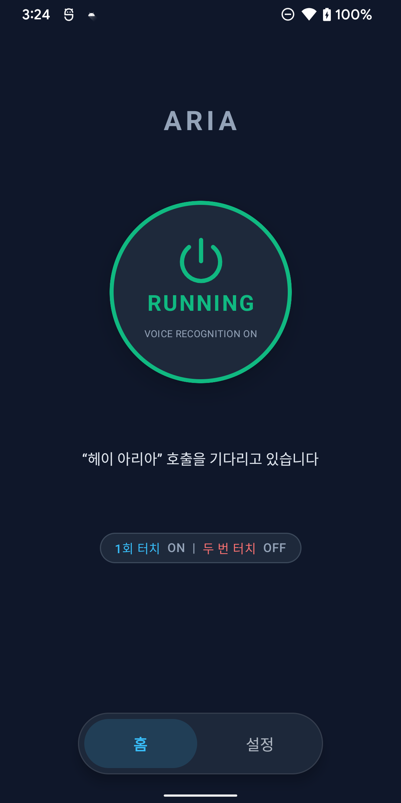</a> | 설정 메인 <a href="02-settings.png">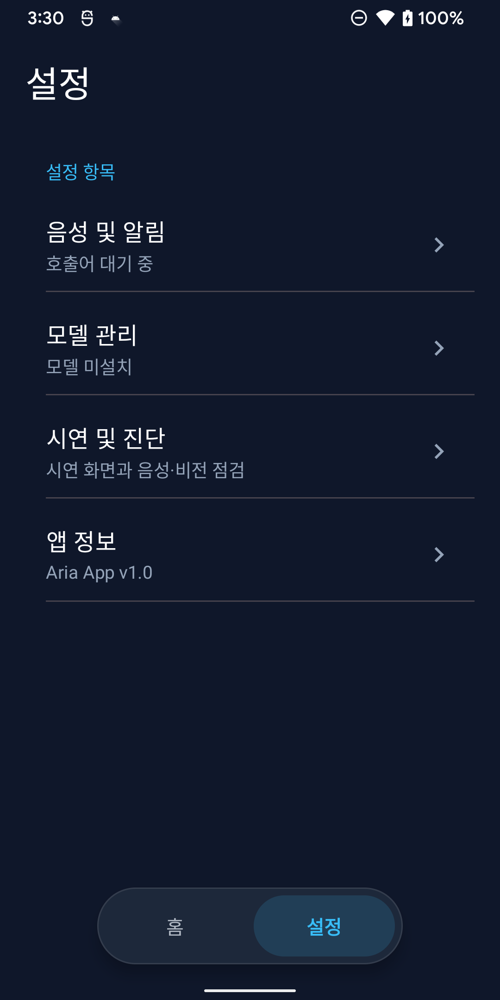</a> |
| 음성 및 알림 <a href="03-voice-settings.png">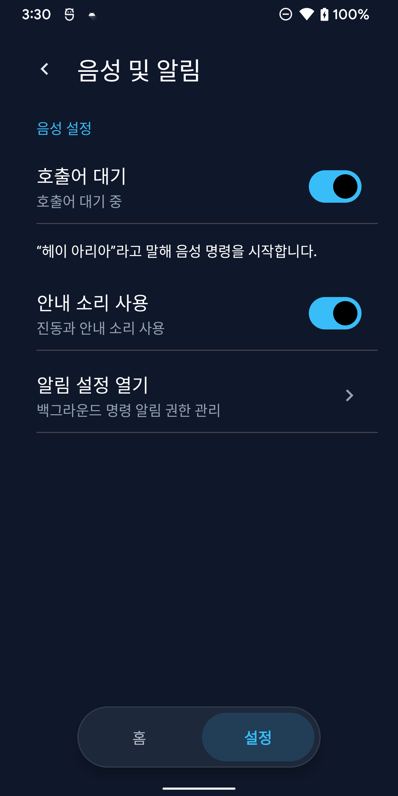</a> | 모델 관리 <a href="04-model-management.png">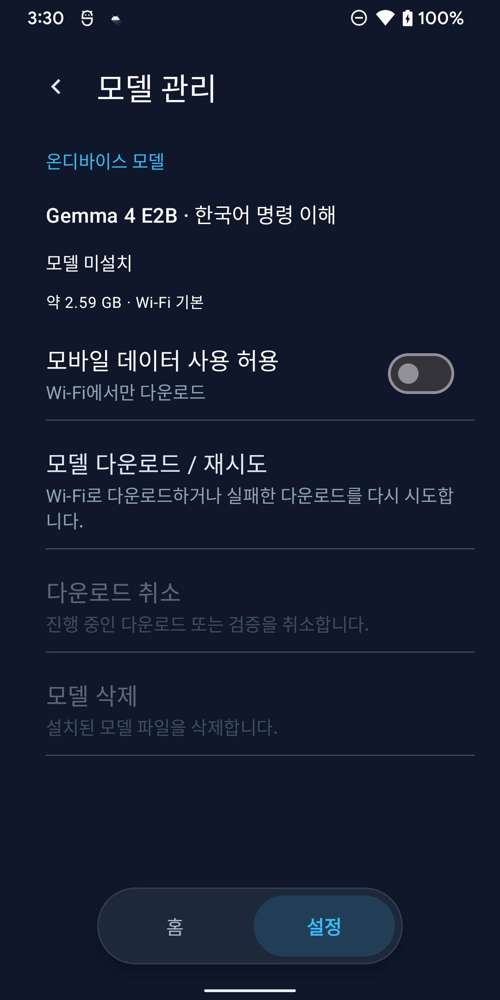</a> |
| 시연 및 진단 메뉴 <a href="05-demo-diagnostics-menu.png">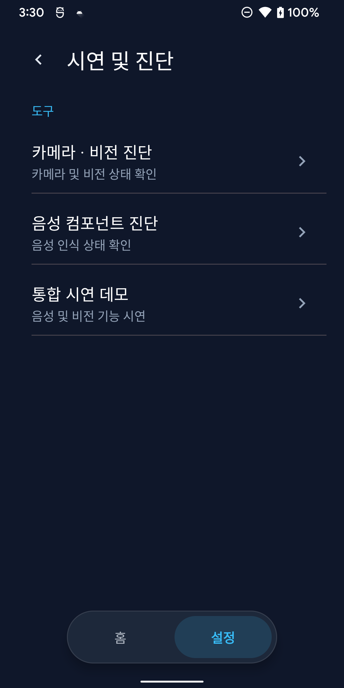</a> | 음성 진단 상단 <a href="06-voice-diagnostics-top.png">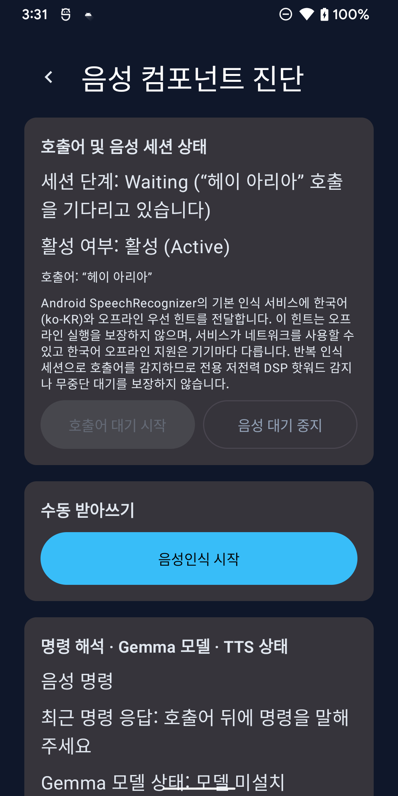</a> |
| 음성 진단 하단 <a href="07-voice-diagnostics-details.png">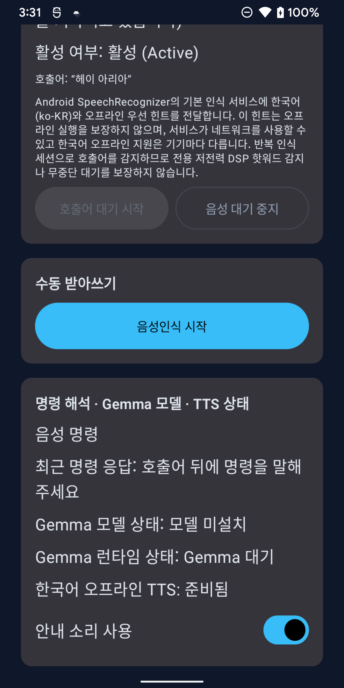</a> | 비전 모델 정보 <a href="08-vision-model.png">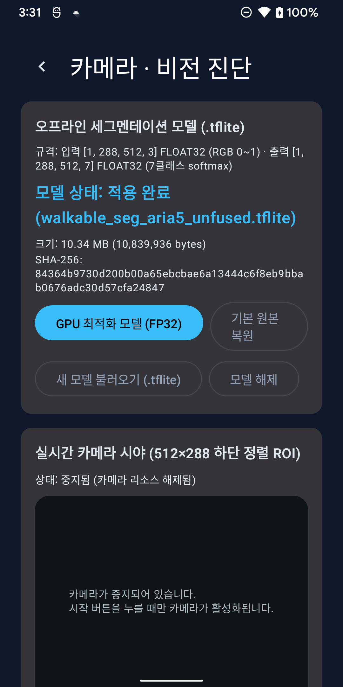</a> |
| 비전 카메라 실행 <a href="09-vision-camera-active.png">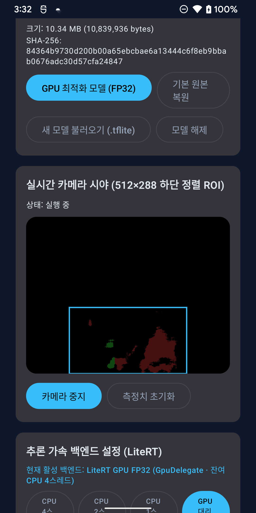</a> | 백엔드와 모션 <a href="10-vision-backend-motion.png">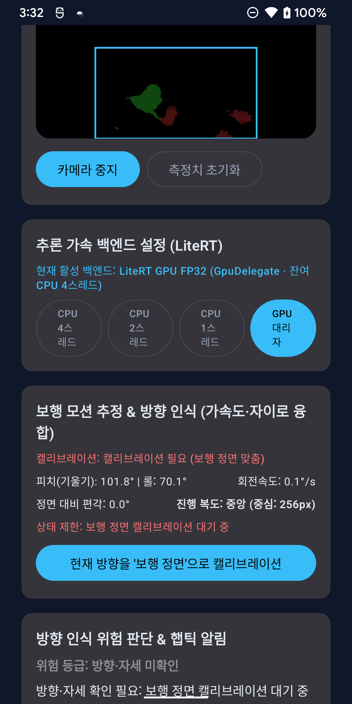</a> |
| 위험 판단과 성능 <a href="11-vision-hazard-performance.png">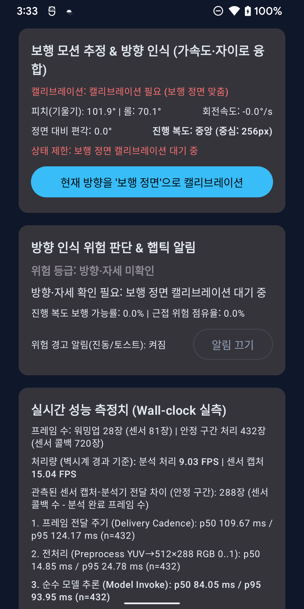</a> | 성능 상세 <a href="12-vision-performance-details.png">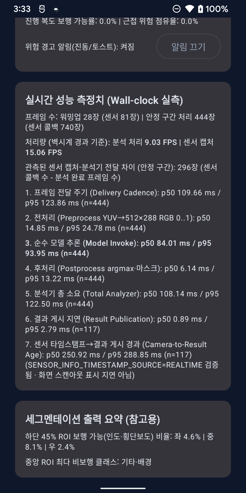</a> |
| 통합 시연 시작 전 <a href="13-integrated-demo-idle.png">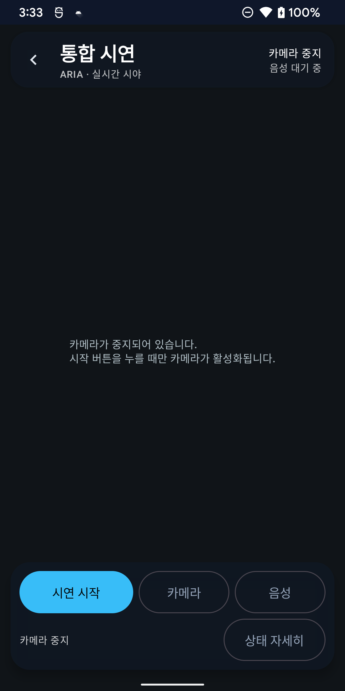</a> | 통합 시연 실행 <a href="14-integrated-demo-active.png">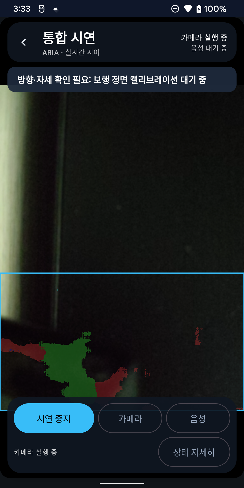</a> |
| 통합 시연 상태 시트 <a href="15-integrated-demo-status.png">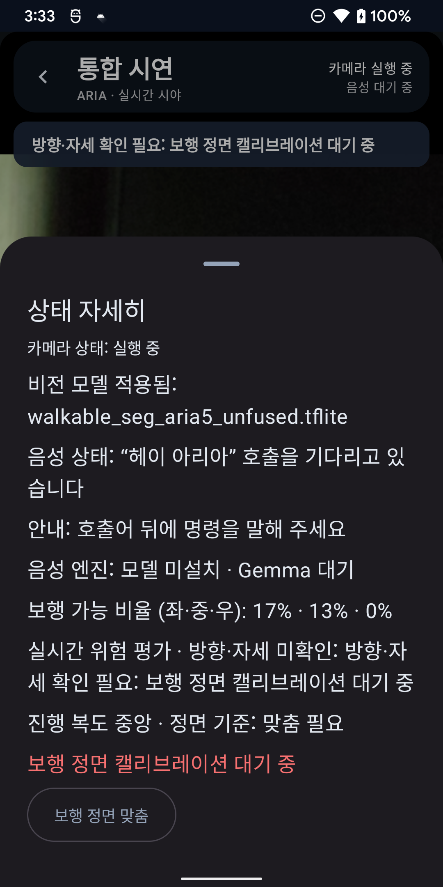</a> | 앱 정보 <a href="16-app-info.png">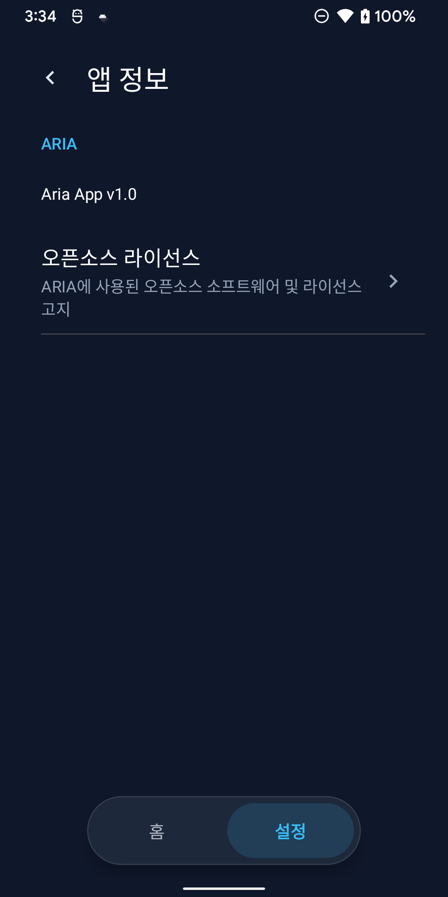</a> |
| 오픈소스 라이선스 <a href="17-open-source-licenses.png">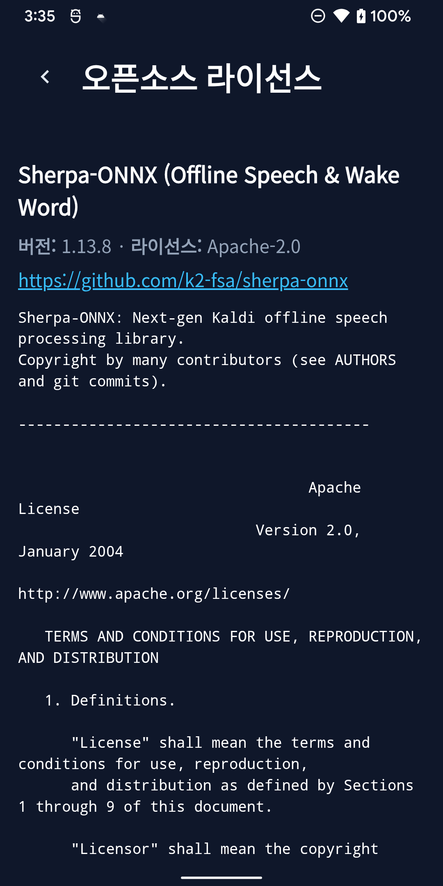</a> | 홈 · 음성 중지 <a href="18-home-paused.png">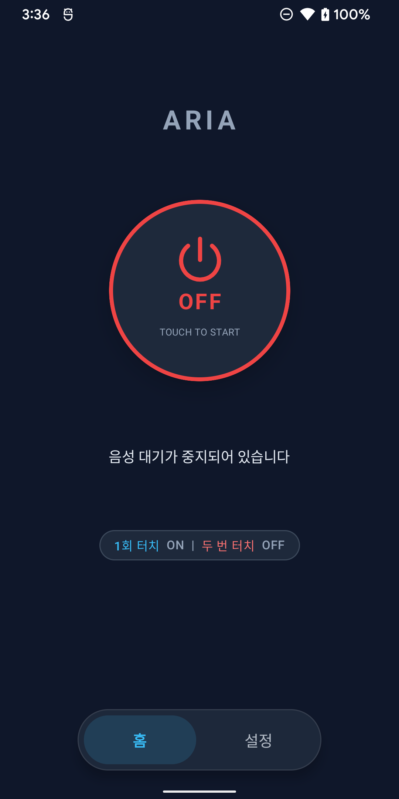</a> |

설치 APK SHA-256: `c1c493203a7e4268adc08aacf82f8830c1e28c8965bb9d304fb195dfd77914da`.
